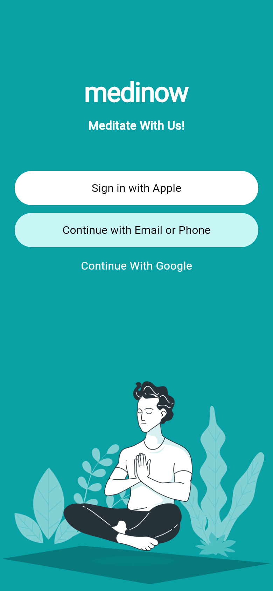
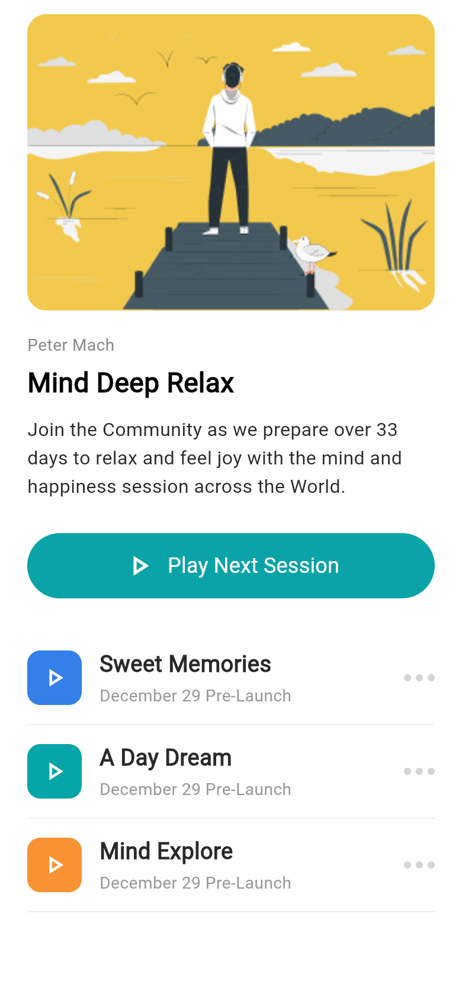
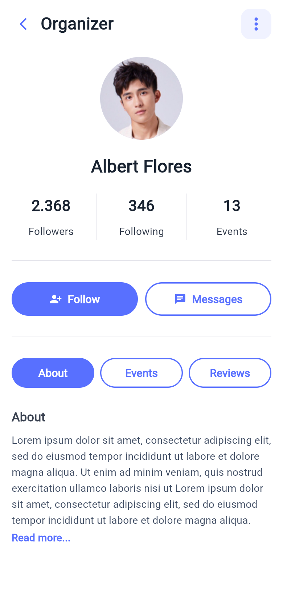
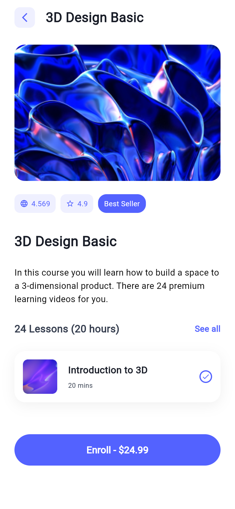

# pr1_flutter

Вёрстка четырёх мобильных экранов на Flutter по готовым макетам · *Four mobile screens built in Flutter from design mockups*

`Flutter` `Dart` `Material`

<p align="center">
  
  
  
  
</p>

## Что сделано
- **Medinow: экран авторизации** (`main.dart`): название и подзаголовок, кнопки входа через Apple, Email/Phone и Google, иллюстрация
- **Mind Deep Relax: экран курса медитаций** (`mind_relax.dart`): обложка, автор, описание, кнопка следующей сессии, список занятий с аватарами и кнопками воспроизведения
- **Organizer: профиль организатора** (`organizer.dart`): фото, имя, статистика, кнопки Follow и Messages, вкладки About / Events / Reviews, описание
- **3D Design Basic: страница курса** (`course.dart`): изображение, рейтинг и число оценок, описание, количество уроков, первый урок, кнопка записи
- Используемые виджеты: `Scaffold`, `SafeArea`, `SingleChildScrollView`, `Column`, `Row`, `Container`, `ClipRRect`, `CircleAvatar`, `Image.asset`, `ElevatedButton`, `OutlinedButton`, `Divider`
- Картинки лежат в `assets/images` и подключены через `pubspec.yaml`

## Структура
```
lib/
├── main.dart         # Medinow: экран авторизации
├── mind_relax.dart   # Mind Deep Relax: курс медитаций
├── organizer.dart    # Organizer: профиль организатора
└── course.dart       # 3D Design Basic: страница курса
assets/images/        # иллюстрации и фото для экранов
```

## Запуск
Каждый экран — отдельное приложение со своим `main()`:
```bash
flutter pub get
flutter run -t lib/main.dart
flutter run -t lib/mind_relax.dart
flutter run -t lib/organizer.dart
flutter run -t lib/course.dart
```

---

## English

Four mobile screens built in Flutter from design mockups.

### Features
- **Medinow sign-in screen** (`main.dart`): title, subtitle, Apple / Email-Phone / Google sign-in buttons, illustration
- **Mind Deep Relax meditation course** (`mind_relax.dart`): cover, author, description, next-session button, lesson list with avatars and play buttons
- **Organizer profile** (`organizer.dart`): photo, name, stats, Follow / Messages buttons, About / Events / Reviews tabs, description
- **3D Design Basic course page** (`course.dart`): image, rating and review count, description, lesson count, first lesson, enroll button
- Widgets used: `Scaffold`, `SafeArea`, `SingleChildScrollView`, `Column`, `Row`, `Container`, `ClipRRect`, `CircleAvatar`, `Image.asset`, `ElevatedButton`, `OutlinedButton`, `Divider`
- Images live in `assets/images` and are registered in `pubspec.yaml`

### Structure
```
lib/
├── main.dart         # Medinow sign-in
├── mind_relax.dart   # Mind Deep Relax course
├── organizer.dart    # Organizer profile
└── course.dart       # 3D Design Basic course page
assets/images/        # screen images
```

### Run
Each screen is a separate app with its own `main()`:
```bash
flutter pub get
flutter run -t lib/main.dart        # or mind_relax.dart / organizer.dart / course.dart
```
